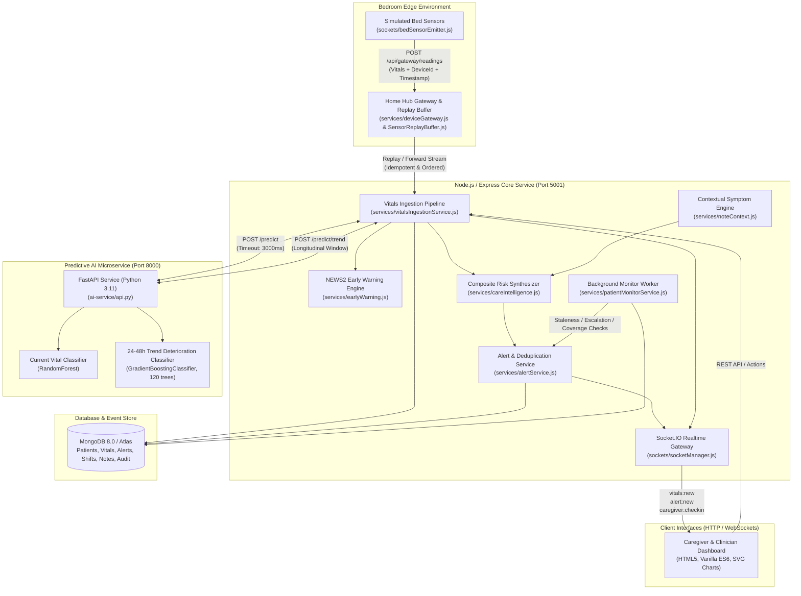
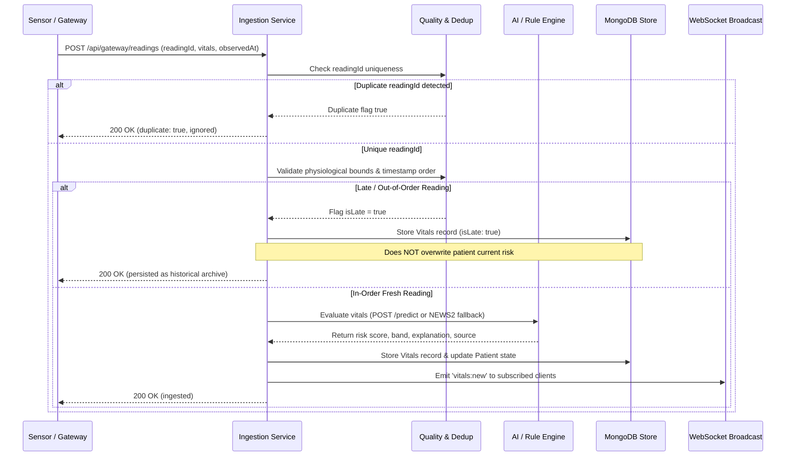
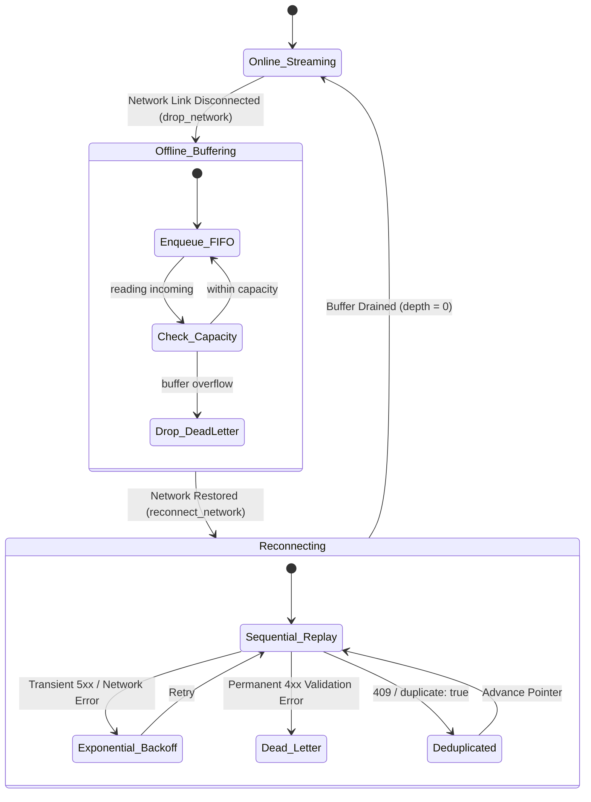

# Care-Verse: Ward Zero
## Technical Architecture & Implementation Specification

**Project:** Care-Verse: Ward Zero  
**Hackathon Initiative:** Operation Ward Zero (Healthcare Technology Hackathon)  
**Mission Loop:** Sense → Understand → Predict → Alert → Respond  
**Repository:** https://github.com/tanmayyyyayyy/care-verse-ward-zero  
**Demonstration Video:** `TODO (team): [Demo Video URL]`  
**Team Identification:** CRADUO — Tanmay Jain & Saanchi Jain  
**System Status:** Functional Engineering Prototype (Synthetic Data Only; Non-Clinical Device)  
**Date of Verification:** November 2026  

---

### Executive Summary

Care-Verse: Ward Zero is an edge-resilient, full-stack home healthcare monitoring and caregiver clinical decision-support platform designed to transform a standard residential bedroom into a safe, continuous, and intelligently monitored home healthcare ward. In traditional post-acute, palliative, and chronic home-care settings, patient safety depends on family caregivers and home aides who lack continuous monitoring tools, physiological trend projection, and structured clinical escalation pathways. Consequently, early clinical deterioration is frequently overlooked until an emergency hospital readmission becomes unavoidable.

Ward Zero addresses this gap by executing an automated, end-to-end operational loop:
1. **Sense:** Continuously ingests five core vital signs (heart rate, blood pressure, oxygen saturation, respiratory rate, body temperature) alongside telemetry metadata from simulated bedroom edge sensors.
2. **Understand:** Enforces strict multi-tier validation, evaluates physiological status against an explainable National Early Warning Score 2 (NEWS2) heuristic engine, cross-references unstructured caregiver clinical notes via a negation-aware symptom extractor, and determines composite patient risk using an asymmetric safety architecture.
3. **Predict:** Projects future physiological trajectory over a 24-to-48-hour forward horizon using a 30-feature Gradient Boosting classifier trained on longitudinal synthetic trajectories, providing early warnings before acute deterioration thresholds are breached.
4. **Alert:** Generates prioritized, deterministically de-duplicated alerts routed to accountable personnel with plain-language physiological drivers and audit tracking.
5. **Respond:** Enforces operational accountability through structured caregiver check-ins, idle/unresponsive presence tracking, timed and audited alert acknowledgments, and an automatic multi-tier escalation ladder (Caregiver → Doctor → Administrator) with zero clinical transfer authority.

The system is fully decoupled, resilient to prolonged edge network disconnections via a persistent replay buffer with bounded exponential backoff, and features built-in failure injection tooling to verify system robustness under degraded operating conditions.

---

## 1. Problem Understanding and Proposed Solution

### 1.1 The Home Healthcare Monitoring Gap
Acute hospital wards achieve low failure-to-rescue rates through continuous patient telemetry, structured physiological scoring systems, standardized shift handovers, and dedicated rapid-response escalation protocols. In contrast, when patients are discharged home to recover in a bedroom environment, a critical monitoring deficit emerges:
- **Telemetry Void:** Vital signs are recorded intermittently (often once or twice daily) using isolated consumer devices without automated clinical aggregation or trend analysis.
- **Subclinical Deterioration Blindspots:** Physiological deterioration (such as developing sepsis or respiratory failure) typically manifests subclinically 12 to 36 hours prior to overt decompensation. Intermittent snapshot readings consistently fail to detect these subtle longitudinal trends.
- **Caregiver Cognitive Overload:** Family members and non-clinical home health aides are expected to interpret ambiguous clinical symptoms without standardized early warning scoring or contextual guidance.
- **Broken Escalation Chains:** When abnormal signs emerge, caregivers lack structured, traceable communication channels, resulting in delayed calls to emergency services or premature hospital readmissions.
- **Edge Network Vulnerability:** Residential environments suffer from intermittent Wi-Fi drops, power fluctuations, and ISP outages, leading to silent telemetry data loss if monitoring devices cannot store and replay data upon reconnection.

### 1.2 Target User Personas & Operational Roles
Ward Zero structures access, operational responsibilities, and user interfaces around five distinct personas:

| User Persona | System Role | Primary Responsibilities & Interaction Touchpoints |
| :--- | :--- | :--- |
| **Patient** | Monitored Subject | Continuous ambient monitoring in the bedroom; zero interface burden; receives care at home without invasive manual logging. |
| **Home Caregiver / Nurse** | `caregiver` / `nurse` | Physical bedside presence; checks in and out of active duty shifts; logs unstructured observational notes; receives and acknowledges Level 0 alerts within configured SLA timeouts. |
| **Attending Clinician** | `doctor` | Oversees patient cohort remotely; reviews composite risk scores and 24–48h deterioration forecasts; receives escalated Level 1 alerts when bedside caregivers do not respond; orders medical interventions. |
| **Care Coordinator / Admin** | `admin` | Oversees ward-wide operational health; monitors caregiver shift compliance and coverage gaps; receives Level 2 final escalations; executes resilience audits and system health checks. |
| **Family Member** | Read-Only Viewer | Transparent visibility into overall patient well-being, caregiver presence status, and routine monitoring stability without clinical alarm fatigue. |

### 1.3 Mapping the Hackathon Challenges to Implementation
The Operation Ward Zero hackathon brief specified six core functional challenges. Ward Zero addresses all six with concrete, verifiable implementations:

| Hackathon Challenge | Architectural Solution | Implementation Module |
| :--- | :--- | :--- |
| **1. Patient Monitoring** | Continuous ingestion and multi-point validation of 5 vital signs (HR, SpO₂, SBP, DBP, RR, Temp), real-time WebSocket broadcasting, and historical SVG telemetry charting. | `vitalsIngestionService.js`, `bedSensorEmitter.js`, `frontend/index.html` |
| **2. Caregiver Monitoring** | Shift registration, active/idle/unresponsive status tracking, caregiver performance metrics (median acknowledgment latency, alerts resolved), and automated coverage gap detection. | `CaregiverShift.js`, `caregiverService.js`, `patientMonitorService.js`, `frontend/care.js` |
| **3. System Reliability** | Edge device gateway featuring an in-memory/durable file-backed replay buffer, bounded exponential backoff, dead-lettering, late-arrival preservation, and deterministic AI fallback. | `SensorReplayBuffer.js`, `deviceGateway.js`, `vitalsQuality.js`, `vitalsIngestionService.js` |
| **4. Contextual Intelligence** | Multimodal risk synthesis integrating numerical vitals, clinical history (age, post-surgery, high-risk diagnoses), and caregiver notes with negation-aware symptom rule extraction. | `careIntelligence.js`, `noteContext.js`, `config/symptomRules.json` |
| **5. Predictive Analytics** | 24-to-48-hour future deterioration risk forecasting utilizing a 30-feature Gradient Boosting classifier supported by deterministic early warning trend trajectory calculations. | `trend_inference.py`, `trend_model.pkl`, `deteriorationForecast.js`, `api.py` |
| **6. Alert and Escalation** | Deterministic SHA-256 deduplication, SLA acknowledgment timers, and a strict 3-tier escalation ladder (Caregiver → Doctor → Admin) with zero clinical transfer authority. | `alertService.js`, `patientMonitorService.js`, `models/Alert.js` |

---

## 2. System Architecture and Technology Stack

### 2.1 End-to-End System Topology
Ward Zero employs a microservices-based, event-driven architecture decoupled across ingestion, intelligence, persistence, and real-time presentation layers:



### 2.2 Technology Stack & Component Specifications

| Layer / Component | Port | Technologies & Frameworks | Primary Role & Responsibilities | Fallback / Resilience Strategy |
| :--- | :--- | :--- | :--- | :--- |
| **Backend Core Server** | `5001` | Node.js 20, Express 4.18.2, Mongoose 8.0.3, Socket.IO 4.6.1 | REST API routing, schema validation, ingestion pipeline, alert dispatch, audit logging. | Graceful error bubbling, structured HTTP status codes (400, 401, 403, 404, 409, 500). |
| **AI Predictive Service** | `8000` | Python 3.11, FastAPI 0.109.0, scikit-learn 1.4.0, NumPy 1.26.3, Pandas 2.2.0 | Point-in-time risk evaluation (`/predict`), 24–48h longitudinal deterioration forecasting (`/predict/trend`). | Deterministic NEWS2 rule engine fallback tagged `assessmentSource: "fallback"`. |
| **Optional ML Service** | `8001` | Python, TensorFlow 2.15.0, Keras 2.15.0, BiLSTM | Complex deep-learning vitals and bed-safety models (optional research component). | Decoupled; skipped in test suite when offline without affecting core pipeline. |
| **Edge Gateway & Buffer** | Embedded | Node.js, `SensorReplayBuffer.js`, FS stream | Ingestion queue, network outage buffering, deduplicated FIFO replay, dead-letter storage. | Bounded exponential backoff (250ms–5000ms); optional disk persistence via `GATEWAY_BUFFER_PATH`. |
| **Persistence Store** | `27017` | MongoDB 8.0.3 / MongoDB Atlas | Relational document store for patients, telemetry history, alerts, shifts, and tamper logs. | Ingestion failure returns 500; edge buffer retries transient network/DB drops. |
| **Frontend Portal** | `5001` | Vanilla HTML5, CSS3, ES6 JavaScript, Native SVG | Responsive clinical command dashboard, caregiver management hub, real-time telemetry rendering. | Offline status indicators; static fallback patient selection disabled during loading. |

### 2.3 Data Models & Schema Design
The application persists all operational state across six core Mongoose models located in `medbed-fullstack/backend/models/`:

#### 1. `Patient` (`models/Patient.js`)
Represents the home care patient and their clinical configuration:
- `patientId`: String (unique index, e.g., `"P-101"`).
- `name`, `age`, `gender`: Basic demographic profiles.
- `ward`, `bed`: Synthetic home ward identifiers (e.g., `"Ward Zero"`, `"Bed-A"`).
- `condition`: Enumerated clinical condition (`general`, `cardiac`, `hydrocephalus`, `icu`, `orthopaedic`, `respiratory`).
- `diagnosis`: Free-text medical diagnostic summary.
- `isPostSurgery`: Boolean flag indicating heightened post-operative vulnerability.
- `riskLevel`: Current operational risk state (`low`, `medium`, `high`, `unknown`).
- `riskScore`: Numerical composite risk index (0–100 scale).
- `assignedDoctor`: ObjectId ref to `User`.
- `assignedCaregiver`: ObjectId ref to `User` (responsible bedside caregiver).
- `isActive`: Boolean status flag.
- `latestTrendPrediction`: Sub-document caching latest 24–48h prediction (`riskLevel`, `riskScore`, `horizonHours`, `drivers`, `evaluatedAt`).

#### 2. `Vitals` (`models/Vitals.js`)
Immutable time-series telemetry records:
- `patient`: ObjectId ref to `Patient` (indexed).
- `readingId`: String (unique UUID generated at edge sensor).
- `deviceId`: String identifier of the originating hardware/emitter.
- `heartRate`, `spo2`, `bpSystolic`, `bpDiastolic`, `temperature`, `respiratoryRate`: Numerical vital readings.
- `aiFlags`: Sub-document containing Boolean heuristic alerts (`hrAlert`, `spo2Alert`, `bpAlert`).
- `predictedRisk`: Categorical risk classification (`low`, `medium`, `high`, `unknown`).
- `assessmentSource`: Attribution tag (`"ai"` or `"fallback"`).
- `assessmentExplanation`: Plain-text clinical justification.
- `aiRawProba`: Probability array from the classifier.
- `fallbackReason`: Descriptive error reason if AI microservice was bypassed.
- `deviceTimestamp`, `observedAt`, `receivedAt`, `recordedAt`: Microsecond timestamps tracking latency.
- `isLate`: Boolean indicating out-of-order delayed delivery via network replay.
- `source`: Telemetry origin (e.g., `"gateway"`, `"bed_emitter"`, `"simulation"`).

#### 3. `Alert` (`models/Alert.js`)
Operational notification lifecycle entity:
- `patient`: ObjectId ref to `Patient` (indexed).
- `type`: Enumerated category (`hr_high`, `spo2_low`, `bp_high`, `bp_low`, `risk_high`, `sensor_offline`, `data_stale`, `fall_risk`, `battery_low`, `deterioration_risk`, `caregiver_concern`, `caregiver_missed_checkin`, `escalation`, `other`).
- `severity`: Priority level (`info`, `warning`, `critical`).
- `message`: Human-readable summary of the alert condition.
- `dedupKey`: Deterministic hash (`patient_type_window`); unique sparse index over active alerts.
- `sourceReadingId`: Unique ID of the vitals record that triggered the alert.
- `assignedTo`: ObjectId ref to `User` (current responsible personnel).
- `isAcknowledged`: Boolean indicating caregiver/clinician interaction.
- `acknowledgedBy`: ObjectId ref to `User`.
- `acknowledgedAt`: Timestamp of acknowledgment.
- `acknowledgmentLatencyMs`: Measured duration between alert creation and acknowledgment.
- `acknowledgmentNote`: Free-text clinical rationale for acknowledgment.
- `isDismissed`: Boolean dismissal state.
- `dismissedBy`: ObjectId ref to `User`.
- `dismissedAt`, `dismissReason`: Clinician audit documentation.
- `escalationLevel`: Current escalation tier (`0`: Caregiver, `1`: Attending Doctor, `2`: Administrator).
- `escalationHistory`: Array of historical transition objects (`level`, `escalatedAt`, `reason`, `escalatedTo`).

#### 4. `CaregiverShift` (`models/CaregiverShift.js`)
Caregiver presence and shift tracking:
- `caregiver` / `user`: ObjectId ref to `User`.
- `userName`, `role`: Denormalized caregiver profile metadata.
- `patient` / `patients`: ObjectId refs to assigned monitored patients.
- `checkInAt`: Timestamp of shift initiation.
- `checkOutAt`: Timestamp of shift conclusion (null while active).
- `status`: Shift state (`on_duty`, `off_duty`, `missed`).
- `notes`: Caregiver handover or operational comments.
- `lastActivityAt`: Timestamp of latest caregiver interaction in the system.
- `activity`: Sub-document tracking operational performance (`acknowledgedCount`, `dismissedCount`, `notesCount`).
- `autoClosed`: Boolean indicating automated shift expiration.

#### 5. `CareNote` (`models/CareNote.js` / `Note.js`)
Unstructured observational notes recorded by bedside staff:
- `patient`: ObjectId ref to `Patient`.
- `author`: ObjectId ref to `User`.
- `authorName`, `authorRole`: Author attribution metadata.
- `text`: Raw clinical note text.
- `flags`: Array of structured symptoms detected by the rule extractor (`id`, `label`, `level`, `phrase`, `extractor`).
- `createdAt`: Timestamp.

#### 6. `AuditLog` (`models/AuditLog.js`)
Immutable audit trail for compliance and forensic reconstruction:
- `action`: Categorical event type (e.g., `"CHECK_IN"`, `"ACKNOWLEDGE_ALERT"`, `"INJECT_FAULT"`).
- `entityType`: Subject model name (`Patient`, `Alert`, `CaregiverShift`, `Gateway`).
- `entityId`: Identifier of the affected document.
- `patient`: Optional ObjectId ref to related `Patient`.
- `actor`: ObjectId ref to executing `User`.
- `actorRole`: Security role of the actor at execution time.
- `metadata`: Arbitrary context object recording state diffs or error payloads.
- `timestamp`: Immutable event creation timestamp.

---

### 2.4 API and Real-Time Interface Contracts

#### REST API Endpoints

| Method | Route Path | Access Control | Primary Function |
| :--- | :--- | :--- | :--- |
| `POST` | `/api/auth/login` | Public | Authenticates credentials; returns signed JWT. |
| `GET` | `/api/auth/me` | Authenticated | Returns current authenticated user profile and role. |
| `GET` | `/api/patients` | Authenticated | Retrieves all active monitored patients. |
| `GET` | `/api/patients/:id` | Authenticated | Retrieves detailed patient profile and current vitals. |
| `GET` | `/api/patients/:id/vitals` | Authenticated | Retrieves historical time-series vitals for charting. |
| `POST` | `/api/patients/:id/notes` | Caregiver, Nurse, Doctor | Appends clinical care note and extracts symptom flags. |
| `GET` | `/api/patients/:id/trend` | Authenticated | Computes 24–48h deterioration forecast for patient. |
| `GET` | `/api/alerts` | Authenticated | Retrieves active and acknowledged alert items. |
| `POST` | `/api/alerts/:id/acknowledge`| Caregiver, Nurse, Doctor | Acknowledges alert; records latency and audit trail. |
| `POST` | `/api/alerts/:id/dismiss` | Doctor, Admin | Dismisses alert with mandatory clinical justification. |
| `POST` | `/api/caregivers/check-in` | Caregiver, Nurse | Registers on-duty shift for specified patient(s). |
| `POST` | `/api/caregivers/check-out` | Caregiver, Nurse | Closes active shift; records off-duty status. |
| `GET` | `/api/caregivers/on-duty` | Authenticated | Lists currently active on-duty caregivers and roles. |
| `GET` | `/api/caregivers/performance`| Doctor, Admin | Computes SLA metrics: median ACK latency, missed check-ins. |
| `POST` | `/api/gateway/readings` | Gateway / Emitter | Ingests sensor reading; buffers if offline. |
| `GET` | `/api/gateway/status` | Authenticated | Returns edge gateway online state and buffer depth. |
| `POST` | `/api/failure/inject` | Doctor, Admin | Injects simulation faults (`drop_network`, `pause_sensor`). |
| `POST` | `/api/failure/reset` | Doctor, Admin | Clears all active failure injection flags. |
| `POST` | `/api/demo-story/start` | Doctor, Admin | Launches 6-phase automated hackathon walkthrough. |
| `GET` | `/api/health/ready` | Public | Evaluates readiness of MongoDB, AI service, and buffer. |

#### Socket.IO Event Channels

| Event Channel | Direction | Payload Structure | Operational Purpose |
| :--- | :--- | :--- | :--- |
| `subscribe:patient` | Client → Server | `{ patientId: string }` | Joins patient-specific telemetry room. |
| `vitals:new` | Server → Client | `{ patientId, vitals, assessment }` | Streams new vital reading and composite risk score. |
| `alert:new` | Server → Client | `{ alert: AlertDocument }` | Dispatches newly raised alert to dashboard. |
| `alert:acknowledged` | Server → Client | `{ alertId, acknowledgedBy, latencyMs }` | Updates alert state across all active client views. |
| `alert:escalated` | Server → Client | `{ alertId, level, assignedTo }` | Notifies coordinator of escalation tier transition. |
| `caregiver:checkin` | Server → Client | `{ shiftId, caregiverId, name }` | Updates on-duty staffing roster cards in real time. |
| `caregiver:checkout` | Server → Client | `{ shiftId, caregiverId, name }` | Removes caregiver from active on-duty panel. |
| `demo:phase` | Server → Client | `{ phase, title, status, details }` | Synchronizes guided demo story progress banner. |
| `gateway:status` | Server → Client | `{ isOnline, bufferDepth }` | Real-time edge connectivity and queue health indicator. |

---

## 3. Major Features and Implementation

### 3.1 Feature 1: Caregiver Presence & Accountability Monitoring
In residential healthcare, unobserved caregiver absence represents an immediate life-safety hazard. Ward Zero implements active caregiver monitoring through the `CaregiverShift` model and `caregiverService.js`:
- **Shift Registration:** Bedside staff check in via `POST /api/caregivers/check-in`, establishing an explicit association between the caregiver and their assigned patient.
- **Presence State Machine:** Caregivers transition across three tracked presence states:
  - `active`: Interactive system operation within the last 15 minutes (`CAREGIVER_IDLE_MINUTES`).
  - `idle`: No user interaction recorded for > 15 minutes.
  - `unresponsive`: No user interaction recorded for > 45 minutes (`CAREGIVER_UNRESPONSIVE_MINUTES`).
- **Missed Check-In Monitor:** A periodic background monitor (`patientMonitorService.js`) checks for assigned patients lacking an active on-duty caregiver for longer than `CAREGIVER_CHECKIN_TIMEOUT_SECONDS` (configurable, default 1800s; fast-tracked during demo scenarios to 30s). Upon breach, a `caregiver_missed_checkin` warning alert is raised.
- **Strict Escalation Ladder:** Unanswered alerts escalate along an accountable pathway:
  $$\text{Assigned Caregiver (Level 0)} \longrightarrow \text{Attending Doctor (Level 1)} \longrightarrow \text{System Admin (Level 2)}$$
  *Safety Guarantee:* Escalation modifies notification routing and responsibility assignment only; it possesses zero technical authority to initiate a clinical patient transfer.
- **Performance Auditing:** The platform aggregates objective caregiver metrics via `GET /api/caregivers/performance`:
  - Median and 90th percentile acknowledgment latency ($t_{\text{ack}}$).
  - Total alerts acknowledged and dismissed.
  - Frequency of missed shifts and unattended check-in timeouts.

### 3.2 Feature 2: 24–48h Deterioration Risk Prediction
To bridge the gap between reactive alerting and proactive intervention, Ward Zero incorporates an experimental predictive analytics engine:
- **Longitudinal Observation Window:** Evaluates a rolling history of up to 48 hours of time-series vitals (minimum 5 readings required for evaluation).
- **Service Endpoint:** Served via `POST /predict/trend` by the Python FastAPI microservice on port 8000.
- **Explainable Heuristic Projection:** In parallel with machine learning models, `deteriorationForecast.js` fits a least-squares linear trend across vitals, gating predictions through an $R^2 \ge 0.5$ fit quality filter. Projections are clamped to physiological limits and re-scored against the NEWS2 matrix to forecast the exact hour of impending critical breach.
- **Attribution Transparency:** Returns ranked contributing factors (e.g., `rr_delta_baseline`, `spo2_slope`) and plain-language driver summaries.
- **Operational Safety Flag:** All UI components display an unremovable badge stating: `"Experimental — synthetic data; not a clinical device"`.

### 3.3 Feature 3: Contextual Intelligence & Symptom Rule Engine
Clinical decisions cannot rely solely on numerical vitals; qualitative caregiver observations provide vital early context. Ward Zero implements a deterministic, explainable symptom extraction pipeline:
- **Configurable Symptom Definitions:** Symptom definitions are maintained in `config/symptomRules.json`, supporting zero-code clinical rule updates.
- **Negation-Aware Extraction:** `noteContext.js` applies regular-expression boundary scanning to identify clinical keywords while strictly respecting negations:
  - *Positive triggers:* `"patient appears confused"`, `"complaining of severe chest pain"`, `"shallow breathing"`.
  - *Negated expressions (suppressed):* `"no chest pain"`, `"denies shortness of breath"`, `"zero confusion observed"`.
- **Asymmetric Risk Safety Invariant:** Contextual intelligence is strictly asymmetric:
  $$\text{Risk}_{\text{composite}} = \max(\text{Risk}_{\text{vitals}}, \text{Risk}_{\text{context}})$$
  Caregiver notes containing alarming phrases elevate patient risk and establish a high-risk floor. Reassuring notes (`"patient is resting comfortably"`) are displayed for clinical reference but are programmatically forbidden from lowering, suppressing, or clearing an elevated physiological risk score.
- **Consciousness Scoring:** Detection of acute confusion or altered mental status automatically injects 3 points into the NEWS2 scoring engine, reflecting standardized clinical protocols.

### 3.4 Feature 4: Failure Injection Engine & Guided Demo Story
To enable comprehensive verification and hackathon demonstration, Ward Zero features an integrated failure injection and demonstration framework:
- **Failure Injection Modes (`POST /api/failure/inject`):**
  - `drop_network`: Simulates complete residential internet outage by setting the edge gateway offline and routing telemetry to the local replay buffer.
  - `reconnect_network`: Restores connectivity and initiates automated, deduplicated replay.
  - `pause_sensor`: Halts simulated sensor emissions to trigger data staleness and offline detection.
  - `simulate_ai_down`: Simulates microservice crash or network partition, forcing instant fallback to deterministic rule engines.
  - `reset_faults`: Flushes all injected faults and restores nominal operational state.
- **Role-Based Execution Guard:** All failure injection and demo automation routes enforce strict role checks; `nurse` and `caregiver` roles receive `403 Forbidden`. Only `doctor` and `admin` roles may execute failure simulations.
- **6-Phase Guided Demo Story (`POST /api/demo-story/start`):**
  Automates the complete hackathon loop across six sequential phases:
  1. *Sense:* Ingests nominal baseline vitals to establish stable telemetry.
  2. *Understand:* Ingests mild respiratory drift; displays NEWS2 point accumulation.
  3. *Predict:* Ingests sustained multi-hour decline; triggers 24–48h deterioration forecast alert.
  4. *Alert:* Ingests acute vital collapse (SpO₂ < 88%, SBP < 85 mmHg); raises critical deduplicated alert.
  5. *Escalation:* Simulates unattended SLA expiration; transitions alert from Level 0 to Level 1.
  6. *Respond:* Caregiver logs bedside note; clinician acknowledges alert with audit reason.

---

## 4. Data Processing, Analysis, and Risk Assessment

### 4.1 Ingestion and Deduplication Pipeline
Every vital reading received at the backend passes through a multi-stage validation and safety pipeline before affecting patient state:



1. **Idempotency Guard:** Every reading carries a client-generated UUID `readingId`. The ingestion service evaluates an indexed lookup in MongoDB. Duplicate deliveries (common during network replay) return immediately with `{ duplicate: true }` without updating patient status or creating duplicate records.
2. **Late-Arrival Protection:** Readings arriving out of chronological order (e.g., following a network buffer replay where `observedAt` is older than the patient's latest recorded telemetry) are persisted with `isLate: true`. They are safely archived for retrospective charting but are programmatically barred from overwriting the patient's current clinical risk level or generating obsolete alarms.
3. **Multi-Point Physiological Range Clamping:** Numerical vitals are validated against valid bounds (HR: 20–300 bpm, SpO₂: 50–100%, SBP: 40–300 mmHg, RR: 4–60 bpm, Temp: 30–45°C). Out-of-bounds readings are rejected with `422 Unprocessable Entity` and routed to the dead-letter queue.

### 4.2 Early Warning Scoring (NEWS2 Adaptation)
Ward Zero incorporates a transparent, rule-based clinical scoring engine modelled after the Royal College of Physicians National Early Warning Score 2 (NEWS2), calibrated for home healthcare:

| Physiological Parameter | 3 Points | 2 Points | 1 Point | 0 Points (Normal) | 1 Point | 2 Points | 3 Points |
| :--- | :---: | :---: | :---: | :---: | :---: | :---: | :---: |
| **Respiration Rate (bpm)** | $\le 8$ | — | 9–11 | 12–20 | — | 21–24 | $\ge 25$ |
| **$\text{SpO}_2$ Scale 1 (%)** | $\le 91$ | 92–93 | 94–95 | $\ge 96$ | — | — | — |
| **Systolic BP (mmHg)** | $\le 90$ | 91–100 | 101–110 | 111–219 | — | — | $\ge 220$ |
| **Pulse / Heart Rate (bpm)**| $\le 40$ | — | 41–50 | 51–90 | 91–110 | 111–130 | $\ge 131$ |
| **Temperature (°C)** | $\le 35.0$ | — | 35.1–36.0 | 36.1–38.0 | 38.1–39.0 | $\ge 39.1$ | — |
| **Consciousness / Alertness**| — | — | — | Alert | — | — | Confused / CVPU |

#### Decision Thresholds:
- **Low Risk:** Aggregate score 0 to 4. Telemetry indicates physiological stability.
- **Medium Risk:** Aggregate score 5 to 6, OR any single parameter scoring 3 points (red trigger). Demands urgent bedside caregiver review.
- **High Risk:** Aggregate score $\ge 7$. Demands immediate clinician escalation.

### 4.3 Machine Learning Deterioration Trend Model
The longitudinal trend prediction engine in `medbed-fullstack/ai-service/` operates on high-dimensional temporal features extracted across a sliding observation window.

#### 1. Model Architecture & Hyperparameters
- **Classifier:** `GradientBoostingClassifier` (`scikit-learn 1.4.0`).
- **Hyperparameters:** Number of estimators: 120; maximum tree depth: 4; learning rate: 0.08; subsampling ratio: 0.85; random state: 42.
- **Training Artifacts:** `trend_model.pkl`, `trend_features.json`, `trend_metrics.json`.

#### 2. Input Feature Engineering (30 Total Features)
The feature engineering pipeline extracts five mathematical domains:
1. *Hourly Slopes:* Linear regression rate-of-change over time for HR, SpO₂, SBP, RR, and Temperature.
2. *Rolling Statistical Moments:* Mean and standard deviation across the historical window for each vital.
3. *Physiological Variability:* Coefficient of variation ($\text{CV} = \sigma / \mu$) for HR and SpO₂ to capture autonomic instability.
4. *Cumulative Threshold Exposure:* Continuous hours spent in hypoxic ($\text{SpO}_2 < 92\%$), hypotensive ($\text{SBP} < 90\text{ mmHg}$), tachycardic ($\text{HR} > 100\text{ bpm}$), or tachypneic ($\text{RR} > 24\text{ bpm}$) states.
5. *Longitudinal NEWS2 Dynamics:* Latest NEWS2 score, window mean, peak score, and rate-of-change per hour.
6. *Personalized Baseline Deviation:* Current values minus patient-specific baseline vitals.
7. *Clinical Demographics:* Normalized age, post-surgical status, and high-risk diagnostic category indicators.

#### 3. Synthetic Cohort Generation & Evaluation Strategy
*(Source: `docs/MODEL_CARD.md`, `medbed-fullstack/ai-service/trend_metrics.json`)*
- **Cohort Scale:** 400 total simulated patient admissions over 72 continuous hours each (1-hour resolution).
- **Physiological Trajectories:** Simulated trajectories include circadian rhythms (24h sinusoid), stochastic Gaussian noise, gradual respiratory decline, acute septic collapse, transient non-deteriorating fluctuations, and stable controls.
- **Cohort Split Strategy:** Strict chronological patient-level cohort split:
  - **Training Cohort:** Patients 0 to 279 (70% of cohort; 1,680 sliding window samples).
  - **Testing Cohort:** Patients 280 to 399 (30% of cohort; 720 sliding window samples).
  - **Leakage Prevention:** Zero temporal overlap; zero patient-level cross-contamination between training and testing splits.

#### 4. Reproducible Model Evaluation Metrics
*(Command: `cd medbed-fullstack/ai-service && source .venv/bin/activate && python train_trend.py`)*

##### Overall Test Set Performance (720 unseen samples across 120 test patients):
- **Accuracy:** `0.8722` (628 / 720 predictions correct)
- **Macro F1-Score:** `0.8373`
- **Weighted F1-Score:** `0.8662`
- **Macro ROC-AUC (One-vs-Rest):** `0.9408`

##### Per-Class Performance Breakdown:
| Target Class | Precision | Recall | F1-Score | Support (Samples) |
| :--- | :---: | :---: | :---: | :---: |
| **Low Risk** | 0.8798 | 0.9600 | 0.9182 | 450 |
| **Medium Risk** | 0.7542 | 0.5855 | 0.6593 | 152 |
| **High Risk** | 0.9640 | 0.9068 | 0.9345 | 118 |

##### Top 8 Features by Gini Importance:
1. `rr_delta_baseline` (0.2675): Shift in respiratory rate above personalized baseline.
2. `mean_bp` (0.1195): Rolling mean systolic arterial pressure.
3. `news_latest` (0.0836): Current point-in-time NEWS2 score.
4. `spo2_delta_baseline` (0.0567): Oxygen saturation delta from personalized baseline.
5. `hr_delta_baseline` (0.0513): Heart rate delta from personalized baseline.
6. `mean_rr` (0.0394): Rolling mean respiratory rate.
7. `temp_slope` (0.0381): Rate of core temperature change per hour.
8. `mean_spo2` (0.0369): Rolling mean oxygen saturation.

---

## 5. System Reliability, Scalability, and Robustness

### 5.1 Edge Replay Buffer & Outage Recovery
Residential network disconnections are anticipated nominal events rather than edge-case exceptions. The system incorporates an edge-tier replay buffer (`services/SensorReplayBuffer.js`) managed by the gateway (`services/deviceGateway.js`):



- **FIFO Queue Preservation:** Telemetry readings generated during an outage are stored in strict chronological order with original device timestamps and unique UUIDs.
- **Bounded Exponential Backoff:** When reconnecting, the replay loop retries transient failures (e.g., server restarts or network blips) with bounded backoff:
  $$t_{\text{backoff}} = \min(250\text{ ms} \times 2^{\text{retries}}, 5000\text{ ms})$$
- **Dead-Letter Segregation:** Malformed readings returning non-retryable client errors (HTTP 400 or 422) are permanently removed from the primary queue and appended to an isolated dead-letter registry, preventing a corrupt payload from permanently blocking the queue.
- **Persistence Across Reboots:** When configured with `GATEWAY_BUFFER_PATH`, the buffer continuously flushes its queue state to disk as JSON lines, ensuring zero data loss across hardware or process reboots.

### 5.2 Decoupled AI Microservice & Graceful Degradation
The Node.js backend treats the Python AI service as an untrusted, decoupled external component:
- **Strict Network Timeouts:** All requests to `http://127.0.0.1:8000/predict` and `/predict/trend` enforce an aggressive 3000ms timeout (`axios` configuration).
- **Deterministic Heuristic Fallback:** If the AI microservice fails to respond, returns an HTTP 5xx error, or times out, the backend seamlessly switches to the local deterministic NEWS2 engine.
- **Attribution Transparency:** Every persisted record and dashboard badge explicitly flags whether assessment derived from machine learning or rule fallback:
  - Nominal: `{ assessmentSource: "ai", predictedRisk: "high" }`
  - Degraded: `{ assessmentSource: "fallback", fallbackReason: "AI service unreachable" }`
- **Zero Ingestion Blocking:** An AI service outage never delays or halts the ingestion, storage, or alerting of incoming vital signs.

### 5.3 Sensor Staleness & Data Void Handling
A primary failure mode in remote health monitoring is silent sensor failure or wireless detachment. Ward Zero enforces active staleness tracking:
- **Staleness Threshold (`VITALS_STALE_SECONDS = 60`):** If no valid telemetry arrives for a patient within 60 seconds, their dashboard status badge transitions from `"LIVE"` to `"STALE"`.
- **Sensor Offline Threshold (`SENSOR_OFFLINE_SECONDS = 180`):** After 180 seconds of elapsed silence, the patient is flagged `"OFFLINE"`, and a `sensor_offline` alert is dispatched to bedside staff.
- **Absolute Safety Invariant:** When telemetry is missing, corrupted, or stale, the system **strictly prohibits** claiming the patient is "stable" or "low risk". The UI displays:
  $$\text{Status: } \textbf{UNKNOWN — DATA STALE} \quad \vert \quad \text{Action: } \textbf{Needs clinical review}$$

---

## 6. Testing, Verification, and Performance

### 6.1 Verified Automated Test Suite Results
System reliability and compliance with architectural specifications are verified via automated test suites. 

*(Verification Command: `cd medbed-fullstack/backend && npm run test:all`)*

```
Test Suite Execution Summary:
├── Backend Unit & Integration Tests (node:test test/*.test.js)
│   ├── Total Tests: 89
│   ├── Passed: 84 (100% of executable tests)
│   ├── Failed: 0
│   ├── Skipped: 5 (optional medbed-ml service on port 8001; intended decoupling)
│   └── Duration: 648.02 ms
└── Browser End-to-End Suite (Playwright Core test/browser.e2e.js)
    ├── Total Verification Checks: 77
    ├── Passed: 77 (100%)
    ├── Failed: 0
    ├── Execution Phases: 10
    └── Duration: ~105 s (includes 62s mandatory real-time staleness threshold)
```

#### Detailed Breakdown of Unit and Integration Test Coverage (84 Passed Tests):
- **AI Contract & Fallback Mechanics (8 tests):** Validates camelCase-to-snake_case mapping, HTTP 422 fallback, malformed JSON fallback, connection timeout fallback, health check separation.
- **Alert Lifecycle & Deduplication (4 tests):** Validates SHA-256 dedup keys, active alert filtering, dismissal suppression, low-BP and risk alerting without AI flags.
- **NEWS2 Clinical Scoring Engine (5 tests):** Validates zero-score normal baselines, boundary score transitions, single red-parameter escalation, altered consciousness scoring, missing parameter handling.
- **Caregiver Note Extraction & Asymmetric Risk (5 tests):** Validates urgent symptom detection, negation suppression, asymmetric risk floor enforcement, note attribution logging.
- **Trend Deterioration & Forecasting (11 tests):** Validates minimum-data rejection, flat trend stability, declining projection calculations, physiological clamping, $R^2$ noise filtering, live microservice communication, deterministic fallback.
- **Caregiver Presence & Shift Services (6 tests):** Validates check-in/check-out lifecycle, Mongoose pre-validation sync, active/idle/unresponsive status thresholds, median/p90 latency math, missed check-in detection, strict non-transfer escalation routing.
- **Failure Injection & Edge Gateway Buffer (16 tests):** Validates simulated network drops, pause sensor emissions, AI crash simulation, fault resets, role permission guards, FIFO order preservation, exponential backoff retries, dead-letter routing, disk persistence.
- **Data Ingestion Pipeline & Race Safety (8 tests):** Validates reading idempotency, late-arrival preservation, duplicate alert suppression, stale-state enforcement.
- **Simulated Sensor Emitters (5 tests):** Validates normal physiological variance, steady decline patterns, sudden critical drop scenarios, UUID generation.
- **Optional ML Integration (5 tests skipped):** Verifies decoupled graceful degradation when port 8001 is inactive.

#### Detailed Breakdown of Browser E2E Suite (77 Checks Across 10 Phases):
- **Phase 1: Authentication & Session (Checks 1–6):** Login page rendering, invalid credential error handling, doctor login redirection, JWT storage in `localStorage`, role badge display.
- **Phase 2: Navigation & Multi-Page Views (Checks 7–12):** Verification of all primary views (Patients Directory, Transfers, Active Alerts, Sensor Simulation, Settings, Command Dashboard).
- **Phase 3: Patient Selection, Telemetry & Assessment (Checks 13–20):** Dynamic patient roster selection, real-time HR/SpO₂/BP readouts, AI risk badge rendering, data quality badge, clinical explanation text.
- **Phase 4: Scenario Simulation & Alert Lifecycle (Checks 21–25):** Sudden drop scenario triggering, real-time alert dispatch, dashboard acknowledgment, mandatory clinician dismissal rationale prompt and resolution.
- **Phase 5: No-Data Patient Scenario & Safety Guarantees (Checks 26–32):** Creation of zero-telemetry patient via API, verification of `UNKNOWN — NO DATA` badge, ECG `NO DATA` status, assertion that system reports `"Needs clinical review"` and **never** reports `"stable"`.
- **Phase 6: Responsive Layout Verification (Checks 33–39):** Complete viewport audit on Mobile (390×844px) confirming zero horizontal layout overflow (`scrollWidth <= 395px`) across all pages, followed by desktop restoration.
- **Phase 7: Caregiver Monitoring & Presence (Checks 40–47):** Staff on Duty card rendering, real-time Check In / Check Out operations, 24–48h Trend card rendering with synthetic data label, Caregiver Note logging, roster table rendering.
- **Phase 8: Error Integrity & Zero Page Errors (Checks 48–49):** Browser console audit confirming exactly zero uncaught page exceptions and zero unexpected console errors during execution.
- **Phase 9: Failure Injection API & Health Checks (Checks 50–61):** Verification of failure injection REST routes, pause sensor toggles, fault resets, and `/api/health/ready` multi-service health report (Mongo, Socket, Buffer).
- **Phase 10: Role Security, Buffer Replay & Sensor Staleness (Checks 62–77):**
  - Nurse role receives `403 Forbidden` from failure injection and demo story APIs.
  - Gateway drops network; buffer depth rises above 0 while accepting sensor readings offline.
  - Reconnect network drains buffer back to 0; verifies zero duplicate records in patient history.
  - Pauses sensors and waits out the 62-second staleness threshold; verifies dashboard reports `"STALE / OFFLINE"` and `"Needs clinical review"`, confirming system never claims stability during telemetry loss.

---

## 7. Assumptions, Known Issues, and Limitations

### 7.1 Synthetic Data Paradigm & Clinical Boundaries
- **Synthetic Physiological Distributions:** 100% of telemetry, training data, and simulated scenarios are synthetically generated. While modeled on published physiological dynamics and circadian variations, synthetic distributions cannot capture the stochastic complexity, artifact noise, and multi-morbidity interactions of real human patients.
- **Absence of Clinical Validation:** The machine learning models and heuristics have not undergone clinical trials, prospective cohort studies, or formal diagnostic validation.

### 7.2 Technical & Operational Constraints
- **Heuristic Consciousness & Oxygen Assumptions:** The NEWS2 implementation defaults to "room air" for oxygen scale calculations, as ambient bedroom sensors cannot verify nasal cannula flow rates. Patient consciousness is inferred exclusively from caregiver notes.
- **English-Only Natural Language Extraction:** The contextual symptom rule engine utilizes keyword and regular expression phrase patterns calibrated strictly for English. Misspellings, colloquial expressions, or non-English caregiver notes will bypass the extractor.
- **Linear Trend Projections:** The mathematical forecasting engine fits linear trajectories over short windows (up to 48 hours). It is structurally incapable of anticipating acute, non-linear catastrophic events (such as sudden pulmonary embolism or acute cardiac arrest).
- **In-Memory Buffer Durability Boundaries:** While durable disk persistence is supported via `GATEWAY_BUFFER_PATH`, default deployments operate an in-memory buffer queue that would not survive edge device power loss if the configuration variable is omitted.
- **Simulated Communication Channels:** Alert escalations update in-app WebSocket channels and internal database records. Integration with real-world cellular SMS, automated voice calls, or pagers is not implemented and represents future production work.

---

## 8. Responsible Use, Safety, and Compliance

### 8.1 Non-Medical Device Classification & Intended Use
Care-Verse: Ward Zero is strictly an experimental software prototype designed to demonstrate IoT telemetry, predictive analytics, and caregiver coordination workflows for the Operation Ward Zero hackathon.
- **Explicit Prohibition:** The system is **not** an FDA-cleared, CE-marked, or clinically certified medical device. It must **never** be deployed to diagnose, treat, prevent, or triage any human disease or medical condition.
- **Human Clinician Primacy:** The software functions solely as an informational decision-support tool. It possesses zero clinical transfer authority and must never supersede the clinical judgment of a licensed physician or trained nurse.

### 8.2 Asymmetric Risk Safety Invariant
To guard against fatal false-negative classifications, the architecture enforces an asymmetric risk design:
- Caregiver observations, symptom notes, or deteriorating trends are permitted to elevate a patient's risk band and establish an un-downgradeable risk floor.
- Reassuring notes (`"patient is smiling"`) or missing telemetry are strictly prohibited from lowering, suppressing, or clearing an elevated risk score.
- Missing or stale telemetry produces an explicit `"UNKNOWN"` state demanding manual clinical review, completely eliminating the hazard of silent, reassuring failures.

### 8.3 Security Architecture and Audit Trail
- **Authentication & Authorization:** All API access requires stateless JSON Web Tokens (JWT) signed with HMAC-SHA256. Passwords are salted and hashed using `bcryptjs` (salt rounds: 10). Role-based access control (`admin`, `doctor`, `nurse`, `caregiver`) is enforced via middleware (`protect`, `authorize`).
- **Immutable Audit Logging:** All sensitive operational actions—including alert acknowledgments, alert dismissals, caregiver shift state changes, note submissions, and failure injection toggles—are written to an append-only `AuditLog` collection in MongoDB, capturing actor ID, actor role, action category, affected entity, and microsecond timestamps.
- **Synthetic Credential Hygiene:** The repository seeds synthetic credentials (`WardZero!2026`) strictly for automated testing and local hackathon evaluation. Production deployment would require external OAuth2/OIDC identity provider integration.

---

## 9. Deployment, Operations, and Maintenance

### 9.1 Environment Configuration Reference
The core backend server is configured via environment variables documented in `medbed-fullstack/backend/.env.example`:

| Environment Variable | Default Value | Description |
| :--- | :--- | :--- |
| `PORT` | `5001` | Core HTTP / WebSocket listening port. |
| `MONGO_URI` | `mongodb://localhost:27017/careverse` | Connection URI for MongoDB database cluster. |
| `JWT_SECRET` | *(Required in env)* | Cryptographic secret for signing session JWTs. |
| `JWT_EXPIRES_IN` | `7d` | Token validity duration. |
| `AI_SERVICE_URL` | `http://127.0.0.1:8000` | Base URL for FastAPI predictive microservice. |
| `ML_SERVICE_URL` | `http://127.0.0.1:8001` | Base URL for optional TensorFlow microservice. |
| `ML_TIMEOUT_MS` | `5000` | Network request timeout for optional ML service. |
| `PATIENT_MONITOR_INTERVAL_MS`| `15000` | Background monitoring loop execution period (15s). |
| `ALERT_ACK_TIMEOUT_SECONDS` | `300` | Nominal SLA timeout for Level 0 alert acknowledgment (300s). |
| `VITALS_STALE_SECONDS` | `60` | Elapsed telemetry silence before marking data stale (60s). |
| `SENSOR_OFFLINE_SECONDS` | `180` | Elapsed silence before flagging sensor offline (180s). |
| `CAREGIVER_IDLE_MINUTES` | `15` | Caregiver inactivity window before marking status idle. |
| `CAREGIVER_UNRESPONSIVE_MINUTES`| `45` | Caregiver inactivity window before marking status unresponsive. |
| `CAREGIVER_CHECKIN_TIMEOUT_SECONDS`| `1800` | Uncovered patient duration before raising missed check-in alert (1800s). |
| `COVERAGE_GRACE_SECONDS` | `60` | Grace period for uncovered critical alerts before coordinator escalation. |
| `GATEWAY_BUFFER_PATH` | *(Optional)* | Local filesystem path for persistent edge replay queue. |
| `DEMO_PASSWORD` | `WardZero!2026` | Standard password seeded for synthetic demonstration accounts. |

### 9.2 Demonstration Credentials
The test suite and local database seeder configure four role-specific synthetic demonstration accounts:

| Role | Username / Email | Password | Intended Test Functionality |
| :--- | :--- | :--- | :--- |
| **Doctor** | `doctor@careverse.com` | `WardZero!2026` | Cohort clinical oversight, alert dismissal, failure injection, demo story. |
| **Nurse** | `nurse@careverse.com` | `WardZero!2026` | Clinical care delivery, shift check-in, alert acknowledgment. |
| **Caregiver** | `caregiver@careverse.com` | `WardZero!2026` | Bedside attendance, shift check-in/out, care note submission. |
| **Admin** | `admin@careverse.com` | `WardZero!2026` | Staffing management, audit log review, failure injection, demo story. |

---

## 10. Appendix: Glossary & Theoretical Foundations

- **NEWS2 (National Early Warning Score 2):** An aggregate physiological scoring system developed by the Royal College of Physicians to standardize the detection of clinical deterioration in acute care.
- **Idempotency Key / ReadingId:** A unique client-assigned UUID attached to each sensor reading to ensure that replayed or retried network packets produce exactly one persistent record.
- **Dead-Letter Queue (DLQ):** An isolated storage queue for telemetry payloads that fail schema validation with non-retryable errors (HTTP 400/422), preventing pipeline deadlocks.
- **Replay Buffer:** A local, ordered FIFO queue at the edge home hub that buffers telemetry during network partitions and streams them sequentially upon link restoration.
- **Asymmetric Risk Synthesis:** An architectural safety principle wherein qualitative context or observational flags are permitted to raise clinical risk levels, but are programmatically forbidden from downgrading an existing high-risk score.
- **Escalation Ladder:** An automated, time-bound notification chain that transfers alert responsibility from bedside caregivers to attending clinicians and system administrators when acknowledgment SLAs expire.

